# Catalog Models

This page describes the data models behind every catalog entry: which fields each kind of entry has and what they mean. It is a reference for developers using `coralmap`.

The models are Pydantic classes in [`src/coralmap/models/`](../src/coralmap/models/), and they are the source of truth. The JSON Schemas in [`schema/`](../schema/) are generated from them with `pixi run generate-json-schemas`. To change a field, edit the model, regenerate the schemas, and commit both together.

**A loaded library is read-only.** Every model is *frozen*: once an entry is loaded, setting one of its fields raises an error. List-like fields are tuples rather than lists, so they cannot be added to or edited either. To change an entry, change its YAML file and load the library again.

**Undeclared fields are rejected, with one exception.** Every catalog model inherits from `Base`, which rejects any field the model does not declare unless the field's name starts with `_`. Underscore fields are internal notes for authors, and `public_fields()` removes them before anything is published.

**Contract fields are the ones you can rely on.** A field declared with `contract()` is a *contract field*: code that uses the library can depend on it. `Base.contract_fields()` returns just those fields from a loaded entry, including inside nested models. Every other field, such as the outcome fields on `Impact.body`, is kept for authoring and is not part of that promise.

**Reading the diagrams:**

- `+` marks a contract field, and `~` a field kept only in the catalog.
- A filled diamond (`*--`) is a nested object that is always present. A hollow diamond (`o--`) is a nested object that may be missing.
- A plain arrow is a reference to another entry, stored as that entry's id rather than as the entry itself.
- `KlId` is an entry id: `kl-` followed by six digits.

A field whose type is an enum takes one of the values of the matching class in [`vocabularies.py`](../src/coralmap/vocabularies.py), which also says what each value means.

## Which model is which schema

| Model | `type` | Schema |
|---|---|---|
| `AiBehavior` | `ai_behavior` | [`ai_behavior.schema.json`](../schema/ai_behavior.schema.json) |
| `UserBehavior` | `user_behavior` | [`user_behavior.schema.json`](../schema/user_behavior.schema.json) |
| `Impact` | `impact` | [`impact.schema.json`](../schema/impact.schema.json) |
| `Pathway` | `pathway` | [`pathway.schema.json`](../schema/pathway.schema.json) |
| `Mechanism` | `mechanism` | [`mechanism.schema.json`](../schema/mechanism.schema.json) |
| `PersonContext` | `context` | [`context.schema.json`](../schema/context.schema.json) |
| `ContextDimension` | `context_dimension` | [`context_dimension.schema.json`](../schema/context_dimension.schema.json) |
| `ContextValue` | `context_value` | [`context_value.schema.json`](../schema/context_value.schema.json) |
| `ExperienceCluster` | `experience_cluster` | [`experience_cluster.schema.json`](../schema/experience_cluster.schema.json) |
| `OperatorAction` | `operator_action` | [`operator_action.schema.json`](../schema/operator_action.schema.json) |
| `Contrast` | `contrast` | [`contrast.schema.json`](../schema/contrast.schema.json) |
| `Divergence` | `divergence` | [`divergence.schema.json`](../schema/divergence.schema.json) |
| `Source` | `source` | [`source.schema.json`](../schema/source.schema.json) |

`Source` describes a cited work. It is not an `Entry`: it makes no claims and has no evidence rating (`standing`) of its own.

## How entries point at each other

An entry never contains another entry. It refers to one by id, in a field whose name says what the relationship is. For code that needs to walk every relationship the same way, `edges()` turns those fields into one list of `Edge` records. `preconditions()` and `observations()` split a pathway's `composition_parts` by `role`; they are computed when called, not stored.

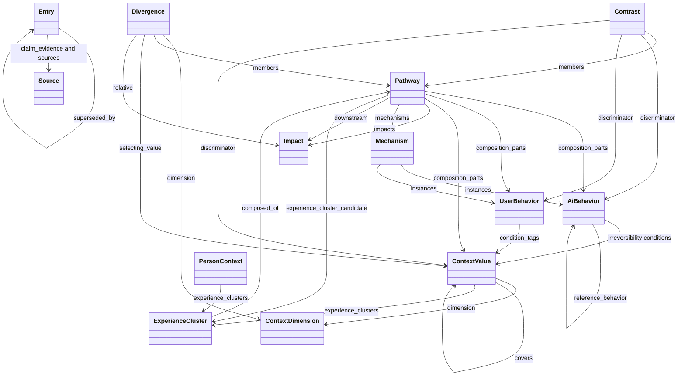

`Entry` is the shared envelope. Every arrow out of `Entry` is inherited by every entry type below. `composition_parts` and `discriminator` each hold a `BehaviorPart` or a `ContextPart`; the arrow above follows the part's `kind` to the entry it names. An owed behavior part (`id: OWED`) names a requirement, not an entry, so it is not a reference.

## Class Structure

```mermaid
classDiagram
    direction TB

    class Base {
        <<frozen>>
    }
    class Entry {
        <<envelope>>
    }
    class Edge {
        <<computed>>
    }

    Base <|-- Entry

    Base <|-- Claim
    Base <|-- ClaimEvidence
    Base <|-- StandingBlock
    Base <|-- Lifecycle
    Base <|-- DistinguishFrom
    Base <|-- CasePassage
    Base <|-- EntrySource
    Base <|-- Contested
    Base <|-- Measurement
    Base <|-- CompositionRow

    Entry *-- Lifecycle : lifecycle
    Entry *-- DistinguishFrom : distinguish_from
    Entry *-- Claim : claims
    Entry *-- ClaimEvidence : claim_evidence
    Entry o-- StandingBlock : standing
    Entry *-- EntrySource : sources
    Entry o-- Contested : contested
    Entry o-- Measurement : measurement
    Entry *-- CompositionRow : composed_of
    EntrySource *-- CasePassage : evidence
    Entry ..> Edge : edges

    Entry <|-- AiBehavior
    Entry <|-- UserBehavior
    Entry <|-- Impact
    Entry <|-- Pathway
    Entry <|-- ExperienceCluster
    Entry <|-- Contrast
    Entry <|-- Divergence
    Entry <|-- ContextDimension
    Entry <|-- ContextValue
    Entry <|-- PersonContext
    Entry <|-- Mechanism
    Entry <|-- OperatorAction

    Base <|-- BehaviorBody
    BehaviorBody <|-- AiBehaviorBody
    BehaviorBody <|-- UserBehaviorBody
    Base <|-- Irreversibility
    AiBehavior *-- AiBehaviorBody : body
    UserBehavior *-- UserBehaviorBody : body
    AiBehaviorBody o-- Irreversibility : irreversibility

    Base <|-- ImpactBody
    Base <|-- BehaviorPart
    Base <|-- ContextPart
    Base <|-- PathwayImpactEdge
    Base <|-- PathwayBody
    Base <|-- ExperienceClusterBody
    Base <|-- ContrastBody
    Base <|-- DivergenceMember
    Base <|-- RelativeStrength
    Base <|-- DivergenceBody
    Impact *-- ImpactBody : body
    Pathway *-- PathwayBody : body
    ExperienceCluster *-- ExperienceClusterBody : body
    Contrast *-- ContrastBody : body
    Divergence *-- DivergenceBody : body
    PathwayBody *-- BehaviorPart : composition_parts
    PathwayBody *-- ContextPart : composition_parts
    PathwayBody *-- PathwayImpactEdge : impacts
    PathwayImpactEdge *-- CasePassage : evidence
    ContrastBody *-- BehaviorPart : discriminator
    ContrastBody *-- ContextPart : discriminator
    DivergenceBody *-- DivergenceMember : members
    DivergenceBody *-- RelativeStrength : relative

    Base <|-- ContextDimensionBody
    Base <|-- Bounds
    Base <|-- ContextValueBody
    Base <|-- PersonContextBody
    ContextDimension *-- ContextDimensionBody : body
    ContextValue *-- ContextValueBody : body
    PersonContext *-- PersonContextBody : body
    ContextValueBody o-- Bounds : bounds

    Base <|-- MechanismBody
    Base <|-- OperatorActionBody
    Base <|-- SourceBody
    Base <|-- Source
    Mechanism *-- MechanismBody : body
    OperatorAction *-- OperatorActionBody : body
    Source *-- SourceBody : body
    Source o-- Lifecycle : lifecycle
    Source o-- StandingBlock : standing
```

`Part` is not a class. It is the union `BehaviorPart | ContextPart`, chosen by the `kind` field. A non-deprecated entry must have `claims` and `standing`; a deprecated entry is exempt, because retiring it is not a grounding failure.

## Evidence

The fields that record what supports an entry. They sit on the entry itself, not inside `body`.

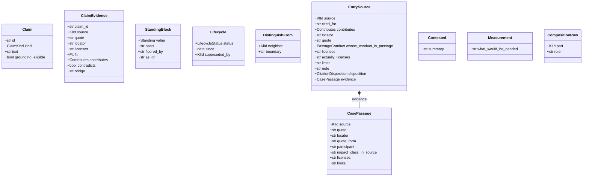

### `Claim`

One assertion the entry makes, small enough to check on its own. Evidence attaches to individual claims, not to the entry as a whole.

| Field | Type | Contract | Meaning |
|---|---|---|---|
| `id` | `str` | no | Local id, unique within the entry, such as `c1`. |
| `kind` | `ClaimKind` | no | What kind of assertion this is: existence, definition, boundary, prevalence, harm, detectability, context dependence, pathway link, or detection window. |
| `text` | `str` | no | The claim in one sentence, stated so it could be false. |
| `grounding_eligible` | `bool \| None` | no | `false` when no citation can support it, so a missing citation is not a gap. Omitted when citations can attach. |

### `ClaimEvidence`

One row for each pairing of a claim with a source. A passage that supports two claims appears in two rows, so counting rows counts pairings, not distinct works cited.

| Field | Type | Contract | Meaning |
|---|---|---|---|
| `claim_id` | `str` | no | The local claim id this row attaches to. Must name a `claims` id on the same entry. |
| `source` | `KlId` | no | The cited work: a `Source.id`. |
| `quote` | `str` | no | Verbatim from the source. A paraphrase fails the later machine check. |
| `locator` | `str` | no | Where in the source: section, table, figure, or page. |
| `licenses` | `str` | no | What this quote establishes for this claim. At least as strong as the claim. |
| `fit` | `Fit` | no | Domain distance between the source and the claim. |
| `contributes` | `Contributes` | no | The evidence role. Some roles cannot license an occurrence claim. |
| `contradicts` | `bool` | no | The quote cuts against the claim. Default `false`. Required `true` when `contributes` is `counterexample`. |
| `bridge` | `str \| None` | no | The inference from what the source shows to what the claim asserts. Required when `fit` is `adjacent` or `analogical`. |

`contributes: context_dependence` is allowed only on a pathway that has a `context_value` part. The outcome turning on a fact about the test case is that part.

### `StandingBlock`

The entry's evidence rating, judged by reading the sources. An entry is rated only as strongly as its weakest claim among those a citation could support.

| Field | Type | Contract | Meaning |
|---|---|---|---|
| `value` | `Standing` | no | The verdict. |
| `basis` | `str \| None` | no | Why this value was reached. |
| `floored_by` | `str \| None` | no | Which claim set the minimum. |
| `as_of` | `str \| None` | no | When standing was last judged. |

### `Lifecycle`

| Field | Type | Contract | Meaning |
|---|---|---|---|
| `status` | `LifecycleStatus` | yes | `draft`, `active`, or `deprecated`. |
| `since` | date or null | no | When the entry entered this status. |
| `superseded_by` | `tuple[KlId, ...]` | no | Entries that replace this one. Only a deprecated entry may name successors. Empty when it was retired with nothing in its place. |

### `DistinguishFrom`

| Field | Type | Contract | Meaning |
|---|---|---|---|
| `neighbor` | `KlId` | yes | The neighboring entry. |
| `boundary` | `str` | yes | What separates this entry from that neighbor. |

### `CasePassage`

A passage about one person in a source, used where the citation rests on individual cases.

| Field | Type | Contract | Meaning |
|---|---|---|---|
| `source` | `KlId` | no | The cited work. |
| `quote` | `str` | no | The passage, verbatim. |
| `locator` | `str` | no | Where in the source. |
| `quote_form` | `str \| None` | no | What kind of passage, such as the person's own words or the authors' description. |
| `participant` | `str \| None` | no | The source's label for that person, such as `P23`. |
| `impact_class_in_source` | `str \| None` | no | The source's own name for the category the passage falls under. |
| `licenses` | `str \| None` | no | What the passage establishes. |
| `limits` | `str \| None` | no | What it does not establish. |

### `EntrySource`

A citation against the entry as a whole, beside `claim_evidence`.

| Field | Type | Contract | Meaning |
|---|---|---|---|
| `source` | `KlId` | no | The cited work. |
| `cited_for` | `str` | no | What the passage is cited for, in prose. |
| `contributes` | `Contributes` | no | The evidence role. |
| `locator` | `str \| None` | no | Where in the source. |
| `quote` | `str \| None` | no | The passage, verbatim. |
| `whose_conduct_in_passage` | `PassageConduct \| None` | no | Whose conduct the passage shows. A passage about only the AI says nothing observed about the person. |
| `licenses` | `str \| None` | no | What the passage establishes. |
| `actually_licenses` | `str \| None` | no | What it supports on a strict reading, where that is narrower than `licenses` or `contributes`. |
| `limits` | `str \| None` | no | What it does not establish. |
| `note` | `str \| None` | no | A fact a reader needs in order to weigh the passage. |
| `disposition` | `CitationDisposition \| None` | no | Set when the source was read and found to support nothing the entry asserts, or to cut against it. |
| `evidence` | `tuple[CasePassage, ...]` | no | Individual cases the citation rests on. |

### `Contested`

| Field | Type | Contract | Meaning |
|---|---|---|---|
| `summary` | `str` | no | An open question about whether the entry should exist as stated, and what each answer would mean. |

### `Measurement`

| Field | Type | Contract | Meaning |
|---|---|---|---|
| `what_would_be_needed` | `str` | no | The instrument or label that would measure the construct, and what existing instruments lack. Written where none does. |

### `CompositionRow`

| Field | Type | Contract | Meaning |
|---|---|---|---|
| `part` | `KlId` | no | A constituent entry, where this entry is a composite. |
| `role` | `str` | no | What that constituent contributes. |

## Entry Envelope

Every catalog entry carries these fields. The per-type payload is `body`, declared on the subclass.

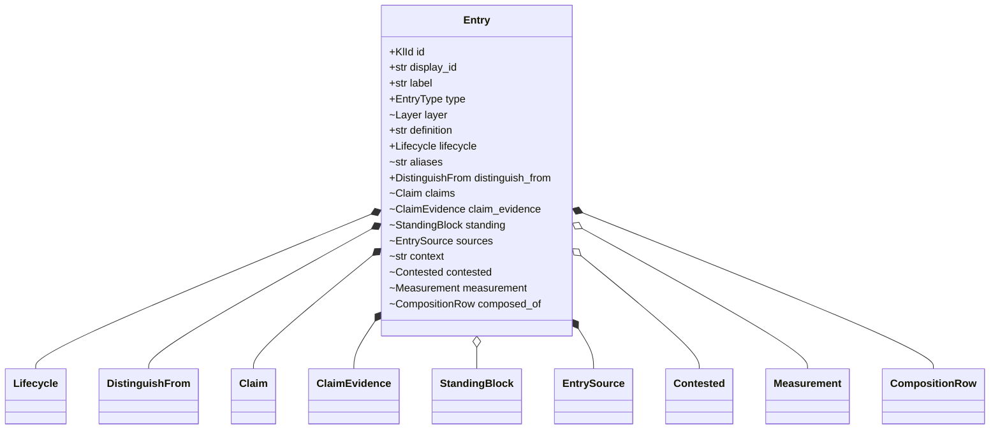

| Field | Type | Contract | Meaning |
|---|---|---|---|
| `id` | `KlId` | yes | Stable identifier. Consumers look entries up by this. |
| `display_id` | `str` | yes | Human-facing handle, such as `Pathway-5`. It changes when the entry's family of entries is renamed. |
| `label` | `str` | yes | Short human name. |
| `type` | `EntryType` | yes | Which slot the entry belongs to. Each subclass fixes it to one literal. |
| `layer` | `Layer` | no | What kind of thing the entry asserts: observation, judgment, process, context, or operator. |
| `definition` | `str` | yes | What must be true for the entry to apply. The prose a generator paraphrases. |
| `lifecycle` | `Lifecycle` | yes | Draft, active, or retired. |
| `aliases` | `tuple[str, ...]` | no | Other handles a consumer may show. On `ContextValue` and `PersonContext` this field is redeclared as a contract field. |
| `distinguish_from` | `tuple[DistinguishFrom, ...]` | yes | Boundaries against the neighbors this entry is confused with. |
| `claims` | `tuple[Claim, ...]` | no | The entry decomposed into independently falsifiable assertions. Required unless the entry is deprecated. |
| `claim_evidence` | `tuple[ClaimEvidence, ...]` | no | External evidence, one row per claim-source pair. |
| `standing` | `StandingBlock \| None` | no | The evidential-strength verdict. Required unless the entry is deprecated. |
| `sources` | `tuple[EntrySource, ...]` | no | Evidence cited against the whole entry rather than one claim. |
| `context` | `tuple[str, ...]` | no | References to standing notes about the territory. Those notes license no entry. |
| `contested` | `Contested \| None` | no | An open question about whether the entry should exist as stated. |
| `measurement` | `Measurement \| None` | no | What it would take to measure the construct, where no surveyed instrument does. |
| `composed_of` | `tuple[CompositionRow, ...]` | no | Constituents, where the entry is a composite. Experience clusters use a separate `body.composed_of` of their own shape. |

## Observation

What can be read directly from a conversation transcript. Each behavior states its own criteria for when it is present, and a pathway that names the behavior relies on those criteria rather than restating them.

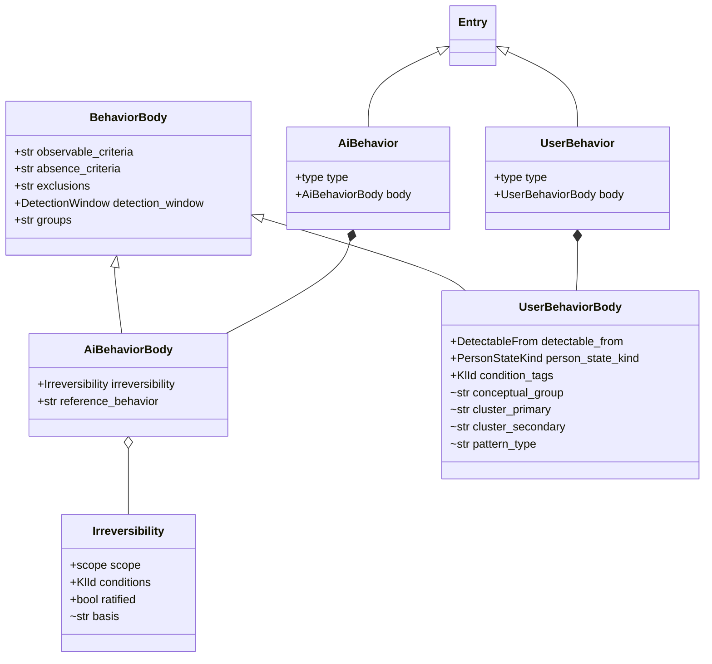

### `BehaviorBody`

Shared by AI and user behaviors. A behavior carries present-criteria or absence-criteria.

| Field | Type | Contract | Meaning |
|---|---|---|---|
| `observable_criteria` | `str \| None` | yes | What must be literally present to count the behavior, checkable against a transcript. |
| `absence_criteria` | `str \| None` | yes | What must be absent, for an omission-shaped behavior. Used instead of `observable_criteria`. |
| `exclusions` | `str` | yes | What looks similar and does not count. |
| `detection_window` | `DetectionWindow` | yes | The minimum span that can satisfy the criteria. A detector may read more. |
| `groups` | `tuple[str, ...]` | yes | Thematic clusters this behavior belongs to. |

### `Irreversibility`

Set on an AI behavior whose harm no later response in that conversation can undo.

| Field | Type | Contract | Meaning |
|---|---|---|---|
| `scope` | `unconditional` or `condition_specific` | yes | Whether it applies wherever the behavior occurs, or only under named conditions. |
| `conditions` | `tuple[KlId, ...]` | yes | Context value ids. Required when `scope` is `condition_specific`. |
| `ratified` | `bool` | yes | Whether a qualified body has approved the assignment. No default: silence is neither approval nor refusal. |
| `basis` | `str \| None` | no | Where the assignment came from. |

### `AiBehavior` and `AiBehaviorBody`

Conduct by the system, read from its own turns, without inferring intent. `type` is fixed to `ai_behavior`. `body` is a contract field.

| Field | Type | Contract | Meaning |
|---|---|---|---|
| `irreversibility` | `Irreversibility \| None` | yes | Present when the harm, once it has occurred, cannot be undone later in the conversation. |
| `reference_behavior` | `str \| None` | yes | A named counterpart this entry is defined partly by contrast to. |

### `UserBehavior` and `UserBehaviorBody`

Conduct or state on the person's side. `type` is fixed to `user_behavior`. `body` is a contract field. `detectable_from` bounds the claim: a state known only because the person reported it is not an observation of that state.

| Field | Type | Contract | Meaning |
|---|---|---|---|
| `detectable_from` | `DetectableFrom \| None` | yes | What kind of transcript material the behavior is readable from. |
| `person_state_kind` | `PersonStateKind \| None` | yes | Whether this is a process, a pattern, or a state. |
| `condition_tags` | `tuple[KlId, ...]` | yes | Context values this behavior commonly co-occurs with. A hint for a persona generator, not a gate: the behavior counts whatever the person's context. |
| `conceptual_group` | `str \| None` | no | Classification metadata on a symptom behavior. |
| `cluster_primary` | `str \| None` | no | Primary symptom cluster. |
| `cluster_secondary` | `str \| None` | no | Secondary symptom cluster. |
| `pattern_type` | `str \| None` | no | Further classification metadata on a symptom behavior. |

## Judgment

What the catalog claims about what it observes. An impact is the outcome. A pathway is a route from named behaviors to that outcome. An experience cluster is a trajectory made of pathways. A contrast holds the situation fixed and varies the response. A divergence holds the response fixed and varies one context dimension.

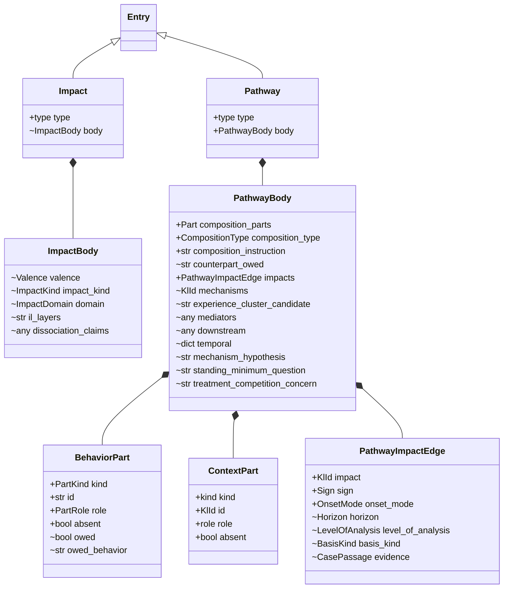

`Part` in `composition_parts` means `BehaviorPart` or `ContextPart`.

### `Impact` and `ImpactBody`

An outcome a pathway leads to. The body says what the outcome is. How it is reached lives on the pathway. `type` is fixed to `impact` and is a contract field. `body` is not: valence, kind, and domain are kept only in the catalog.

| Field | Type | Contract | Meaning |
|---|---|---|---|
| `valence` | `Valence` | no | Whether this is a harm or a benefit. |
| `impact_kind` | `ImpactKind \| None` | no | A state, a pattern, or a foregone benefit. |
| `domain` | `ImpactDomain \| None` | no | The area of life or functioning affected. |
| `il_layers` | `tuple[str, ...]` | no | Cross-reference to an external impact-ladder scheme. Not an edge inside the catalog. |
| `dissociation_claims` | any | no | Where this impact is claimed to occur independently of another. |

### `BehaviorPart`

A part naming a behavior: something that happened, or, under `role: condition`, had to.

| Field | Type | Contract | Meaning |
|---|---|---|---|
| `kind` | `ai_behavior` or `user_behavior` | yes | Which side of the transcript. Must match the target entry's `type`. |
| `id` | `str` | yes | The behavior's `kl-` id, or `OWED` when no entry fills the part yet. |
| `role` | `PartRole` | yes | `condition` gates the claim. Every other role composes it. |
| `absent` | `bool` | yes | The behavior must not occur. Default `false`. The part is still in the composition; the claim is its absence. |
| `owed` | `bool` | no | No entry fills this part yet. Default `false`. Must agree with `id: OWED`. |
| `owed_behavior` | `str \| None` | no | What an entry filling this part would have to assert. Required when `owed`. |

### `ContextPart`

A fact the test case must hold for the pathway to apply. The dimension itself is not gateable; the value is.

| Field | Type | Contract | Meaning |
|---|---|---|---|
| `kind` | `context_value` | yes | Fixed. The part names a context value. |
| `id` | `KlId` | yes | That value's id. |
| `role` | `condition` | yes | Always `condition`. A context value gates and never composes. |
| `absent` | `bool` | yes | The test case records a value on the dimension and it is not this one. An unrecorded dimension satisfies neither the part nor its negation. Default `false`. |

### `PathwayImpactEdge`

| Field | Type | Contract | Meaning |
|---|---|---|---|
| `impact` | `KlId` | yes | The impact this pathway leads to. |
| `sign` | `Sign` | yes | Toward or away from harm. A protective pathway is a positive claim, not a missed detection. |
| `onset_mode` | `OnsetMode \| None` | yes | Whether the impact is new, worsened, foregone, or held in place. |
| `horizon` | `Horizon \| None` | no | How soon the impact follows. |
| `level_of_analysis` | `LevelOfAnalysis \| None` | no | Whether the claim is about this person or a rate. |
| `basis_kind` | `BasisKind \| None` | no | How the causal edge was arrived at. Most edges are specified rather than measured. |
| `evidence` | `tuple[CasePassage, ...]` | no | Passages that bear on this edge. |

### `Pathway` and `PathwayBody`

One authored list, `composition_parts`. `observations()` is the parts whose role composes: what happened. `preconditions()` is the parts whose role is condition-like: the gate. The two views are not stored. Two pathways with the same observations and different preconditions are two entries. `type` is fixed to `pathway`. `body` is a contract field.

`composition_type` describes how the observations compose, not every part. `direct` and `omission` need no instruction. Any other type with more than one observation requires `composition_instruction`, and that instruction must say something the type and the roles do not already say.

| Field | Type | Contract | Meaning |
|---|---|---|---|
| `composition_parts` | `tuple[Part, ...]` | yes | Everything the pathway is composed of or gated by. At least one. |
| `composition_type` | `CompositionType` | yes | How the observations compose. |
| `composition_instruction` | `str \| None` | yes | Composition the type and the roles cannot carry, in the entry's own terms. Read by the judge. |
| `counterpart_owed` | `str \| None` | no | A well-handled counterpart this pathway implies that nobody has authored. |
| `impacts` | `tuple[PathwayImpactEdge, ...]` | yes | Where the pathway leads. At least one. |
| `mechanisms` | `tuple[KlId, ...]` | no | Mechanism entries asserted to drive this pathway. |
| `experience_cluster_candidate` | `str \| None` | no | Flags the pathway as a candidate member of a cluster not yet composed. |
| `mediators` | `tuple[Any, ...]` | no | What sits between the behavior and the outcome. Not an edge: it carries a measure rather than a catalog id. |
| `downstream` | `tuple[Any, ...]` | no | What this pathway's impact in turn feeds. Flattened as an edge when an item carries an impact id. |
| `temporal` | `dict \| None` | no | Timing structure beyond the impact horizon. |
| `mechanism_hypothesis` | `str \| None` | no | A proposed mechanism not yet promoted to a mechanism entry. |
| `standing_minimum_question` | `str \| None` | no | An open question about what this pathway's standing should be floored at. |
| `treatment_competition_concern` | `str \| None` | no | Where the pathway may compete with a treatment the person is already receiving. |

`sign()` over the body is the pathway's overall direction: one sign if the impact edges agree, `mixed` if they do not. `detection_window()` is the widest window among non-absent observations, resolved from those behaviors' own windows. `exclusive_pair()` is true when two pathways share observations and differ in preconditions. It is a view, never an entry. `holds_for_test_case()` says whether one context-value part holds for the values a test case recorded, including covering values and ordered gates. An unrecorded dimension returns unknown, which a gate treats as not holding.

### Experience cluster, contrast, and divergence

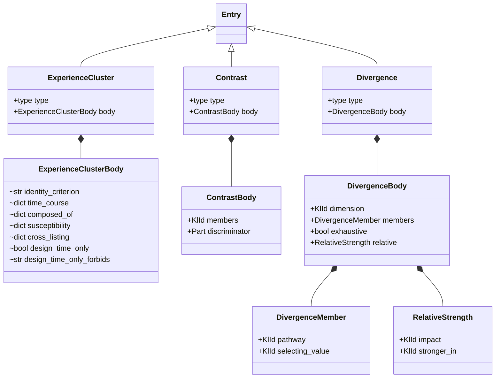

#### `ExperienceCluster` and `ExperienceClusterBody`

A pattern that unfolds over time, made of several pathways, rather than a single route. `type` is `experience_cluster`. `body` itself is a contract field, but none of the fields inside it are yet, so its contents are not part of the promise.

| Field | Type | Contract | Meaning |
|---|---|---|---|
| `identity_criterion` | `str \| None` | no | The membership test for a configuration. |
| `time_course` | `dict \| None` | no | How long the trajectory runs and what shape it takes. Keys: `characteristic_span` and `shape`. |
| `composed_of` | `tuple[dict, ...]` | no | Pathways that instantiate the cluster. Each item has `pathway` (a kl-id), `pathway_alias`, and `narrative_role`. |
| `susceptibility` | `tuple[dict, ...]` | no | Population or subgroup variation. Each item has `kind` and `note`. |
| `cross_listing` | `tuple[dict, ...]` | no | Other clusters this one overlaps, and where the boundary sits. |
| `design_time_only` | `bool \| None` | no | A design-time construct, not something a detector scores at runtime. |
| `design_time_only_forbids` | `str \| None` | no | What that status rules out. |

#### `Contrast` and `ContrastBody`

A harmful pathway paired with the pathway for a well-handled response in the same circumstances. Members share observations and preconditions, so only the response differs, and that difference is authored as `discriminator`. `type` is `contrast`. `body` is a contract field.

| Field | Type | Contract | Meaning |
|---|---|---|---|
| `members` | `tuple[KlId, ...]` | yes | The pathways, two or more, with no repeated id. |
| `discriminator` | `tuple[Part, ...]` | yes | What tells the responses apart. At least one part. |

#### `Divergence`, `DivergenceMember`, `RelativeStrength`, `DivergenceBody`

Pathways over the same observations, told apart by one context dimension. Each member gates on a different value of that dimension. Where the same route is stronger for one value, that comparison is `relative`. `type` is `divergence`. `body` is a contract field.

| Field | Type | Contract | Meaning |
|---|---|---|---|
| `dimension` | `KlId` | yes | The context dimension whose values select the members. |
| `members` | `tuple[DivergenceMember, ...]` | yes | Two or more pathways, each with the value that selects it. Pathways and selecting values are each unique. |
| `exhaustive` | `bool` | yes | Whether the members cover every value of the dimension. |
| `relative` | `tuple[RelativeStrength, ...]` | yes | Where one member leads to a shared impact more strongly than the others. |

`DivergenceMember`:

| Field | Type | Contract | Meaning |
|---|---|---|---|
| `pathway` | `KlId` | yes | The member pathway. |
| `selecting_value` | `KlId` | yes | The context value on `dimension` that selects this member: the value its gate names. |

`RelativeStrength`:

| Field | Type | Contract | Meaning |
|---|---|---|---|
| `impact` | `KlId` | yes | An impact every member leads to. |
| `stronger_in` | `KlId` | yes | The member pathway in which the link to `impact` is stronger. It must name a member. |

## Context

A contextual fact is a value on a dimension. A pathway gate names a `ContextValue`. How a particular evaluation run learned the fact is recorded by that run, not by the catalog. `PersonContext` is the retired shape; every entry of that type is deprecated.

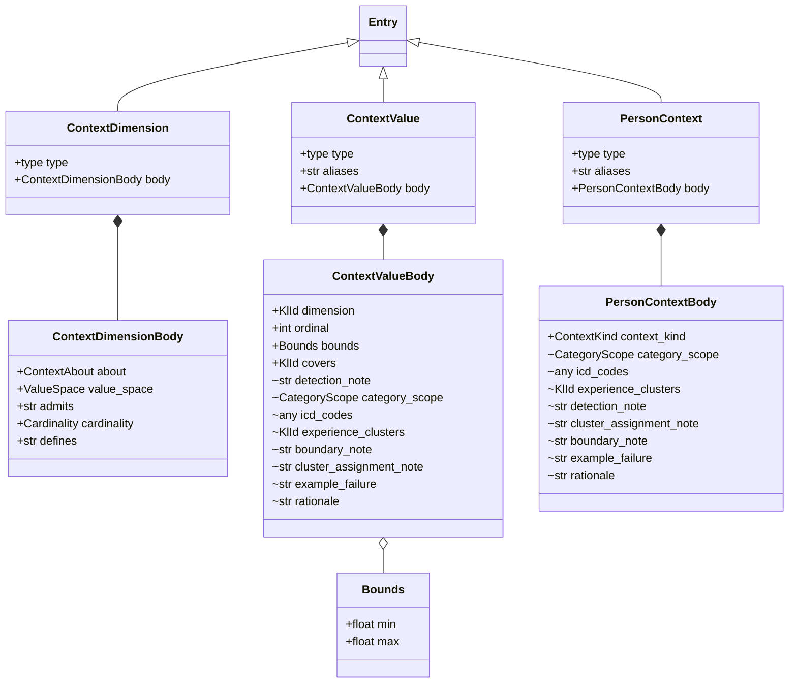

### `ContextDimension` and `ContextDimensionBody`

A dimension a test case is built along. *Session position* is not a claim; *fourth session or later* is, and that is a value. `type` is `context_dimension`. `body` is a contract field.

| Field | Type | Contract | Meaning |
|---|---|---|---|
| `about` | `ContextAbout` | yes | What the facts are about. `person` is recorded on the persona; every other group on the test case. |
| `value_space` | `ValueSpace` | yes | How values are given, which decides how a gate naming one is evaluated. |
| `admits` | `str \| None` | yes | What makes a value admissible. Required when `value_space` is `described`, and only then. |
| `cardinality` | `Cardinality` | yes | Whether a test case records one value or several. An `ordered` dimension is always `one`. |
| `defines` | `str` | yes | What varying this dimension does to a judgment. |

### `Bounds`

The numeric range a value covers, both ends inclusive. A missing end is open.

| Field | Type | Contract | Meaning |
|---|---|---|---|
| `min` | `float \| None` | yes | Lowest number covered. Absent means no lower bound. |
| `max` | `float \| None` | yes | Highest number covered. Absent means no upper bound. |

At least one end is required, and `min` cannot exceed `max`.

### `ContextValue` and `ContextValueBody`

One value on a dimension. The value is the entry: `id`, `label`, `definition`, and its boundaries. The body says which dimension it sits on and how it is read. `type` is `context_value`. `aliases` and `body` are contract fields. `aliases` is the readable tag a consumer shows where a behavior names this value.

A value may stand for several others on its dimension through `covers`. A test case records the specific value; the covering value holds for it. A covered value covers nothing itself. A dimension with covering values is not `ordered`.

| Field | Type | Contract | Meaning |
|---|---|---|---|
| `dimension` | `KlId` | yes | The dimension this value sits on. |
| `ordinal` | `int \| None` | yes | Position on the dimension. Required when the dimension is `ordered`, and only then. Unique within the dimension. A gate holds at this ordinal or above. |
| `bounds` | `Bounds \| None` | yes | The numeric range, where the value bands a number. On every value of a dimension or on none, and never overlapping. |
| `covers` | `tuple[KlId, ...]` | yes | Values on the same dimension this one stands for, when it names a union. Empty on an ordinary value. No repeats. |
| `detection_note` | `str \| None` | no | What in a transcript establishes this value when it is stated or inferred rather than asserted. |
| `category_scope` | `CategoryScope \| None` | no | How tightly this maps to a recognized clinical category. |
| `icd_codes` | any | no | ICD codes this value maps to. A by-analogy code records that no classification covers it. |
| `experience_clusters` | `tuple[KlId, ...]` | no | Experience clusters this value wires to. |
| `boundary_note` | `str \| None` | no | Where this value ends and a neighbor begins. |
| `cluster_assignment_note` | `str \| None` | no | Why it maps to the clusters it lists. |
| `example_failure` | `str \| None` | no | A concrete case of the response failure this value bears on. |
| `rationale` | `str \| None` | no | Why this value is its own entry. |

### `PersonContext` and `PersonContextBody`

The shape the catalog used before dimensions and values. Kept so a retired id can still be loaded. A live contextual fact is a `ContextValue`. `type` is `context`. `aliases` and `body` are contract fields; inside the body, only `context_kind` is.

| Field | Type | Contract | Meaning |
|---|---|---|---|
| `context_kind` | `ContextKind` | yes | What kind of contextual fact this entry recorded. |
| `category_scope` | `CategoryScope \| None` | no | How tightly it maps to a recognized clinical category. |
| `icd_codes` | any | no | ICD-11 codes, including a by-analogy code where no classification covers the entry. |
| `experience_clusters` | `tuple[KlId, ...]` | no | Experience clusters this context wires to. |
| `detection_note` | `str \| None` | no | How reliably it can be inferred from conversation text. |
| `cluster_assignment_note` | `str \| None` | no | Why it maps to the clusters it lists. |
| `boundary_note` | `str \| None` | no | Where it ends and a neighbor begins. |
| `example_failure` | `str \| None` | no | A concrete case of the response failure it bears on. |
| `rationale` | `str \| None` | no | Why it is its own entry. |

## Process and Operator

A mechanism is explanatory: a process asserted to carry behavior to outcome, not something scored off a transcript. An operator action is an act by whoever deployed the system, evidenced outside the transcript. The harm, where it follows, belongs to the pathway.

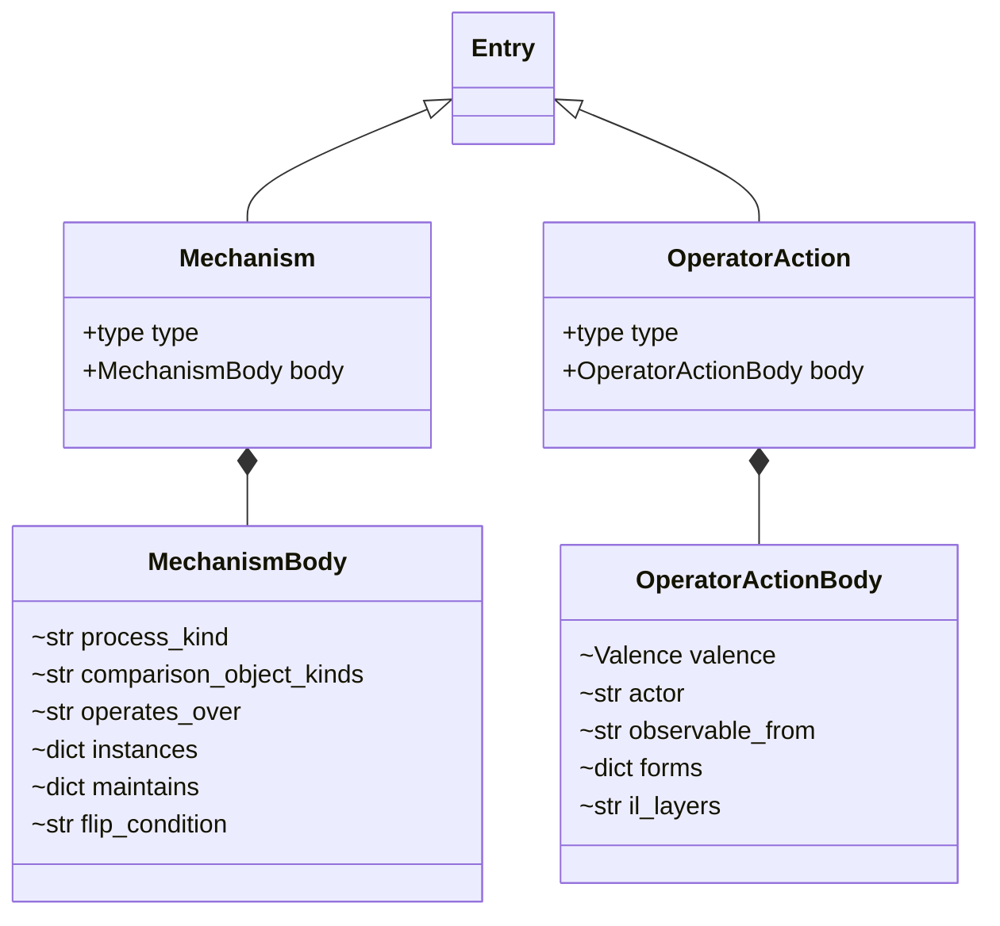

On both types the `body` slot is marked `contract()` and the fields inside are not, same as an experience cluster: `body` itself is a contract field, but the fields inside it are not yet.

### `Mechanism` and `MechanismBody`

`type` is `mechanism`. The body names the operation, not one occurrence of it.

| Field | Type | Contract | Meaning |
|---|---|---|---|
| `process_kind` | `str \| None` | no | The kind of process asserted. |
| `comparison_object_kinds` | `tuple[str, ...]` | no | What the operation is judged against: the counterfactual the claim compares to. |
| `operates_over` | `str \| None` | no | The temporal scope the mechanism presupposes, which may be wider than any one instance's detection window. |
| `instances` | `tuple[dict, ...]` | no | Behaviors this mechanism runs through. Each item has `id`, `content_policy`, `detectable_in`, and `constitutive` (definitional, rather than an example). |
| `maintains` | `tuple[dict, ...]` | no | Clinical conditions the mechanism is asserted to help sustain. Each item has `condition`, `process`, and an optional `note`. Not an edge. |
| `flip_condition` | `str \| None` | no | The condition under which the mechanism's direction reverses. |

### `OperatorAction` and `OperatorActionBody`

`type` is `operator_action`. Recorded as a risk: the action sets the conditions a response is produced under.

| Field | Type | Contract | Meaning |
|---|---|---|---|
| `valence` | `Valence` | no | Recorded as `risk` rather than as a realized harm. |
| `actor` | `str` | no | Who performed the act. |
| `observable_from` | `str` | no | Where the act is documented. Explicitly not the transcript. |
| `forms` | `tuple[dict, ...]` | no | Named sub-forms. Each item has `name` and `note`. A sub-form is a variant of the same act; a distinct act is its own entry. |
| `il_layers` | `tuple[str, ...]` | no | Cross-reference to the external impact-ladder scheme. |

## Provenance

`Source` is one row in the source registry. Citations point here. It carries bibliographic fields and a quality grade, and it is not an `Entry`. Nothing on it is a contract field. Most rows carry a quality grade, and some also carry notes on how the source was retrieved. Fields the model does not declare are still rejected.

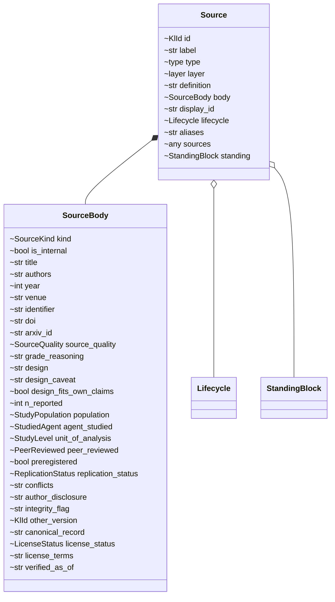

### `Source`

| Field | Type | Contract | Meaning |
|---|---|---|---|
| `id` | `KlId` | no | Stable identifier, the same shape as an entry id. |
| `label` | `str` | no | Short human name. |
| `type` | `source` | no | Fixed discriminator. |
| `layer` | `provenance` | no | Fixed. Provenance sits outside the five layers an entry may carry. |
| `definition` | `str` | no | What this source is, in one or two sentences. |
| `body` | `SourceBody` | no | Bibliographic and quality-grade fields. |
| `display_id` | `str \| None` | no | Readable handle such as `Source-1`. |
| `lifecycle` | `Lifecycle \| None` | no | Draft, active, or deprecated, where the row records one. |
| `aliases` | `tuple[str, ...]` | no | Other handles. |
| `sources` | list, mapping, or null | no | Nested source list, on a provenance row that cites one. |
| `standing` | `StandingBlock \| None` | no | Present only where an older envelope required it. A source has no standing of its own. |

### `SourceBody`

`kind` and `is_internal` are required. Grade fields are optional because some rows were never graded.

| Field | Type | Contract | Meaning |
|---|---|---|---|
| `kind` | `SourceKind` | no | What kind of record. `internal_artifact` and `deliberation_record` are the project's own and are never evidence. |
| `is_internal` | `bool` | no | One of the project's own artifacts rather than external scholarship. A self-citation is not evidence. |
| `title` | `str \| None` | no | The work's title, as the work gives it. |
| `authors` | `tuple[str, ...]` | no | Author surnames, in the work's order. |
| `year` | `int \| None` | no | Year of publication. |
| `venue` | `str \| None` | no | Journal, conference, or preprint server. |
| `identifier` | `str \| None` | no | External identifier, often a DOI or arXiv id. |
| `doi` | `str \| None` | no | DOI, where recorded separately. |
| `arxiv_id` | `str \| None` | no | arXiv id, where recorded separately. |
| `source_quality` | `SourceQuality \| None` | no | The derived grade. Absent on legacy provenance rows. |
| `grade_reasoning` | `str \| None` | no | Why the work received that grade. |
| `design` | `str \| None` | no | How the study was run, where it is empirical. |
| `design_caveat` | `str \| None` | no | Limitations of the design as run. |
| `design_fits_own_claims` | `bool \| None` | no | Whether the design supports the claims the work itself makes. |
| `n_reported` | `int \| None` | no | Sample or instance size as the work states it. |
| `population` | `StudyPopulation \| None` | no | Who was studied. `model_only` means no human participants. |
| `agent_studied` | `StudiedAgent \| None` | no | Whose conduct was observed: the AI system's, people's, or both. |
| `unit_of_analysis` | `StudyLevel \| None` | no | The unit the data was collected over. Distinct from an impact edge's `level_of_analysis`. |
| `peer_reviewed` | `PeerReviewed \| None` | no | Review status of the venue. `unknown` means not established. |
| `preregistered` | `bool`, `"unknown"`, or null | no | Whether the analysis was registered before data collection. |
| `replication_status` | `ReplicationStatus \| None` | no | Whether this work replicates another, or has been replicated. `none_known` asserts absence of knowledge. |
| `conflicts` | `str \| None` | no | Conflicts of interest, as declared or apparent from funding and affiliations. |
| `author_disclosure` | `str \| None` | no | What the authors disclosed about their own stake. |
| `integrity_flag` | `str \| None` | no | Post-publication status: none, expression of concern, correction, or retraction. |
| `other_version` | `KlId \| None` | no | Another source entry for a different text of the same work, such as the published version of a preprint. Set on both when both are registered. |
| `canonical_record` | `str \| None` | no | Where the authoritative record lives. |
| `license_status` | `LicenseStatus \| None` | no | Whether the cited version may be reused. Requires `license_terms` and `verified_as_of` when set. |
| `license_terms` | `str \| None` | no | The license the work states, such as CC BY-NC 3.0, where `license_status` alone does not name it. |
| `verified_as_of` | `str \| None` | no | When the record was last checked against its source, as YYYY-MM-DD. |

`citation_counts()` is not a model. Given entries, it returns how many entries cite each source and how many `claim_evidence` rows do.

## Computed Graph

`Edge` is not authored and not stored on an entry. `edges(entry)` builds it from the typed fields above. Targets come out as authored: usually a `kl-` id, sometimes an alias. Resolving an alias needs the whole library, so it happens in the caller.

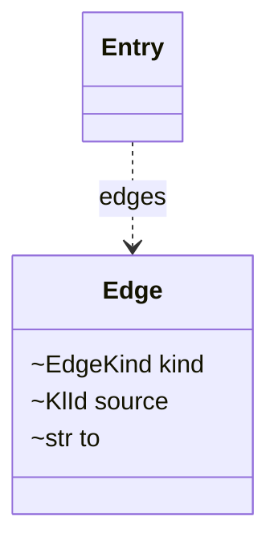

| Field | Type | Contract | Meaning |
|---|---|---|---|
| `kind` | `EdgeKind` | no | Which relation the edge came from: `composition_parts`, `impacts`, `mechanisms`, `downstream`, `cluster_candidate`, `condition_tags`, `irreversibility_conditions`, `reference_behavior`, `covers`, `composed_of`, `instances`, `experience_clusters`, `dimension`, `members`, `discriminator`, `selecting_value`, `relative_impact`, `superseded_by`, `distinguish_from`, or `citation`. |
| `source` | `KlId` | no | The entry the relation is declared on. |
| `to` | `str` | no | The target as authored: a kl-id or an alias. |

Relations that name something outside the catalog are skipped: `il_layers`, `maintains`, and `mediators`.
